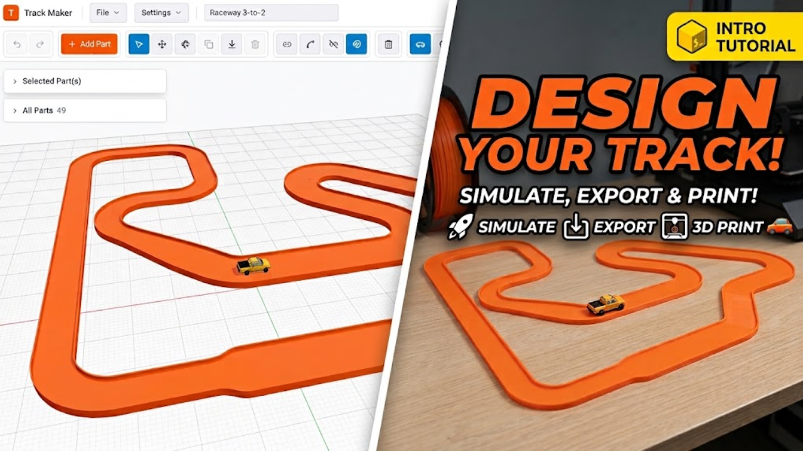

# Track Maker

**Open it: [track-maker.pages.dev](https://track-maker.pages.dev/)**

**Watch the walkthrough: [How to use Track Maker on YouTube](https://www.youtube.com/watch?v=5xtdn3H29Y4)**

Design 3D-printable car track in your browser. Lay out a run from straights,
curves, transitions and junctions, check how many printer plates it needs, drive
a car round it, then export the pieces and their connector clips as 3MF, STL or
OBJ.

Everything runs in the browser. There is nothing to install, no server and no
account.

## What it does

- **Builds track pieces from parameters.** Every piece is generated to the size
  you type — length, radius, sweep, width — rather than picked from a fixed set.
  Widen a piece to 2, 3 or 4 lanes and the lanes merge into one flat channel.
- **Joins them with a printed clip.** Each end has a pocket for a snap-in
  connector clip, short (40mm) or long (70mm), with screw holes to lock it.
- **Plans the print.** It wraps the layout in boxes the size of your printer's
  bed, so you can see how many plates the track needs.
- **Lets you drive it.** Drop a scale car on the track and drive it with the
  keyboard to see how the layout feels before you print it.
- **Exports print-ready files.** 3MF keeps the colour of each part for a
  multi-material printer; STL and OBJ work everywhere else.

## How to use it

1. **Add a piece.** Open the **Parts library** (**A**), pick a Straight, Curve,
   Transition or Junction and its width, and drop it on the workplane. With
   **Snap to selected end** on, each new piece mates to the highlighted end.
2. **Shape it.** Select a piece to edit its length, radius, sweep, widths and
   colour in **Selected Part(s)**. Anything clipped to it follows along.
3. **Join and separate.** **Connect** (**C**) joins two ends; **Disconnect**
   (**X**) frees one. Dragging a joined piece moves its whole assembly, so
   disconnect an end first to move a piece on its own.
4. **Close the loop.** **Close Loop** (**L**) takes two open ends and offers a
   piece that bridges them, or adjusts the pieces already there to fit.
5. **Check the print size.** **Settings ▸ Print** wraps the track in
   printer-sized boxes and lets you choose your printer. Each box is one plate.
6. **Drive it.** Press the **Simulator** button in the toolbar, then use
   **W A S D** or the arrow keys, with space for the handbrake. **R** puts the car
   back at the start and **Esc** returns to editing. Pick the car and its scale
   in **Settings ▸ Vehicle** — 1:64 die-cast, 1:32 slot car, 1:28 RC — or load
   your own `.glb`, `.gltf`, `.3mf`, `.obj` or `.stl` model.
7. **Export.** The **Export** button in the top bar writes the selection or the whole track, with
   the connector clips if you want them. **Clip only** writes a single clip
   lying flat, ready to print in bulk.
8. **Save your work.** **File ▸ Save** downloads the project as a
   `.track.json` file; **File ▸ Open** loads it back.

Want a head start? Download
[`four-lane-circuit.track.json`](./four-lane-circuit.track.json), a closed
four-lane loop, and open it with **File ▸ Open**.

### Tuning the dimensions

**Settings ▸ Dimensions** exposes every measurement of the track profile and the
connector clip, in millimetres. Change a value and every piece rebuilds. **Settings
▸ Connector** chooses whether joints take the short or the long clip.

### Mouse and keyboard

| Input               | Action                          |
| ------------------- | ------------------------------- |
| Left click          | Select a piece                  |
| Right drag          | Rotate the view                 |
| Left or middle drag | Pan                             |
| Scroll              | Zoom                            |
| `V` `G` `R`         | Select, Move, Rotate            |
| `C` `X` `L`         | Connect, Disconnect, Close Loop |
| `A`                 | Parts library                   |
| `D`                 | Drop to workplane               |
| `H` / `F`           | Home view / frame the selection |
| `#`                 | Toggle the grid                 |
| `⌘Z` / `⇧⌘Z`        | Undo / redo                     |
| `⌘D`                | Duplicate                       |
| `Delete`            | Delete the selection            |

## How it works

Parts are generated, not imported. A track piece is a 2D cross-section swept
along a straight or an arc, with a connector pocket at each end. The clip is
built face by face from horizontal layers with its relief slots and countersunk
screw holes cut through. No boolean kernel is involved, which is why length,
radius, angle and lane count are all free parameters. The default dimensions are
measured off STL exports of real printed parts, and a headless audit checks
every generated solid is watertight and the right size.

`CHANGELOG.md` records every change and where each dimension came from.
